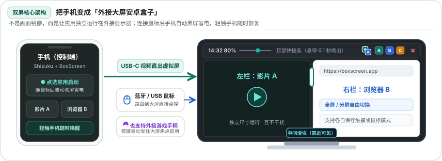

# BoxScreen

BoxScreen 把手机变成一台「安卓盒子」：外接显示器上独立运行安卓应用，以**鼠标为核心输入**进行大屏展示与操作——看视频、玩游戏、轻办公。手机屏幕保留控制界面，外接屏显示所选应用。当前版本支持下方列出的 OnePlus 16 和 OnePlus 8 两种设备与系统配置。

> **当前公开版本：v1.0.22。** 本版新增独立设置页、光学液态玻璃双明暗主题、GitHub Release 应用内检查更新、新版自适应启动图标及外接屏预览/分屏选择器视觉打磨；未修改 OnePlus 16/OnePlus 8 的虚拟屏创建、分屏后端或机型适配接口。

v1.0.22 引入基于 `RuntimeShader`/`RenderEffect` 的光学液态玻璃主题与水滴滑块、外接状态栏背景明暗自适应对比度、紧凑主题化截图预览与分屏选择器、新版石墨银铝启动图标，并将外观/更新/帮助收整进独立设置页。详见[本次发布说明](docs/releases/RELEASE_NOTES_v1.0.22.md)。

仓库文档按使用手册、发布说明、测试和设计方案组织，见[文档索引](docs/README.md)。

## 帮助文档



- **在线阅读完整手势图解**：见 [BoxScreen 使用手册（含全部矢量示意图）](docs/guides/USER_GUIDE_zh-CN.md) — 在 GitHub 仓库页面可直接浏览全部 5 张矢量图解（状态栏 5 向手势、组合图标手势、分界滑块、触摸/鼠标按键对照）。
- **App 内帮助文档**：从首页右上角进入「设置 → 帮助文档」。也可打开[网页版本](docs/guides/OPERATION_GUIDE_zh-CN.html)。

## 功能

- 读取外接显示器当前分辨率和刷新率，运行时创建匹配尺寸的虚拟屏，不写死显示器参数或系统显示 ID。
- 从已安装应用列表中启动应用；第一次点击会按需创建虚拟屏，之后复用当前虚拟屏。
- 横屏输出和竖屏效果一键切换。
- 虚拟屏 DPI 可调，范围 140–600，每格 10 DPI；横屏和竖屏分别保存，松开滑块后应用。外接屏快捷条和面板的文字、控件及点击区域随之缩放。
- 可为指定应用开启主屏 DPI 同步，缓解部分应用因多屏 DPI 不一致造成的文字显示异常；开启期间手机主屏的显示大小也会变化。
- 针对 UU 远程使用专用虚拟屏配置，改善键盘输入后鼠标无法继续操作的问题；切换该应用时会重建虚拟屏。
- 虚拟屏中的每个应用可单独选择触摸或鼠标输入模式，默认使用触摸模式。
- 外接手柄（GAMEPAD / JOYSTICK 设备）接入后会自动解除屏幕绑定，按键和摇杆可以投递到虚拟屏上的应用；需要 Shizuku 授权，且应用窗口本身必须可获焦。
- 触摸模式下鼠标右键=返回、中键=菜单（松开生效）；连点时每 250ms 最多生效一次。鼠标模式下右键/中键由应用自己解释。
- 搜索、收藏应用；可选择是否显示系统应用；应用网格会随屏幕方向和可用宽度调整。
- 手机横竖屏切换时，主界面会重新适配布局；应用列表在首次打开时即可显示；提供实体机械推子滑块。在设置页提供锤子与液态玻璃风格、明暗模式、帮助文档、版本号、检查更新与发行说明入口。
- 鼠标移到外接画面顶部约 100 毫秒会显示快捷条；移开后快捷条和下拉面板约 100 毫秒后收起。快捷条显示 Android 最近任务中的应用（同一应用只显示一个图标；正在保留的分屏组合在状态栏显示左上/右下交叠组合图标，同时保留两个单应用图标，便于直接对单栏应用执行左上拖重启或下拉关闭），点击可切换任务或恢复分屏；拖动图标可将应用放入分屏、重启原位置的前台应用，或关闭对应应用。下拉面板可调节媒体音量和 DPI、切换输入模式和横竖屏，也支持将应用卡片左右拖入分屏。应用搜索保留在手机主界面的应用列表中。
- 可从外接屏快捷面板截取虚拟屏画面，保存到 `Pictures/Screenshots`；截图预览支持删除，或在外接屏用系统图库打开。
- **分屏与后台组合**：快捷面板的“分屏”按钮以虚拟屏当前前台任务作为第一栏，再从选择器里挑第二个应用；状态栏图标或下拉面板应用卡片也可左右拖入分屏（已进入半屏选区时自动遮蔽底层全屏应用防止透底）。分屏期间打开其他应用会在后台保留当前分屏组合（单组），点击状态栏组合图标即可恢复，通过右上角 `×` 或下滑关闭上层应用时也会自动切回该组合；直接启动组合内单个应用则会拆散后台组合。
- **组合手势**：按住状态栏分屏组合图标，在图标左右边界内**向上拖过上边界**松开可无损拆散组合（前台/后台均不结束进程），在左右边界内**向下拖过下边界**松开可同时关闭组合中的两个应用。
- 分屏滑块只在鼠标靠近时分界显示，拖动可实时调整比例，松手生效；点击不拖则交换两栏。
- 长按滑块弹出分栏菜单（─ □ ✕）：最小化、最大化或关闭屏幕上的那一栏，按钮按视觉位置区分左右，交换后不会错位。
- 最大化与最小化只隐藏应用、不结束进程；重新从选择器选中被隐藏的应用即可带着原状态回到分屏。
- 有外接鼠标时，**点击应用启动后**自动把鼠标转发到外接屏上的虚拟画面，并将手机屏幕调暗、显示黑屏。触摸手机可恢复黑屏和原来的窗口亮度。
- 竖屏时鼠标指针顺时针旋转 90°；切换方向时指针位置按屏幕比例映射，鼠标移动和点击仍对应虚拟屏。
- 主界面提供“手机黑屏”按钮，可随时手动黑屏；触摸手机恢复。
- **大画面自动缓冲**：画面超过 250 万像素（例如 2560×1440）时，BoxScreen 自动启用中间缓冲，减少外接屏上的重复帧。竖屏缓冲需要 Android 16 或更新版本，并复用直出路径的图层旋转。缓冲需要额外的 GPU 绘制和显存，延迟取决于实际合成。

## 与同类工具的定位差异

- **屏连 / 屏易连**：安卓应用流转与异屏串流组合（常配 Moonlight/Sunshine），走串流编码路径；BoxScreen 用 DisplayManager 虚拟屏直出视频信号，无编码开销，且内置鼠标路由与快捷面板。
- **Extend (android-display-extend)**：DeX 级开源替代，核心交互是手机主屏当多点触控板 + 屏幕键盘；BoxScreen 有意走**真鼠标优先**路线（自绘指针、右键=返回/中键=菜单、快捷面板），不做手机触控板模式。
- **纯投屏类（AirDroid Cast 等）**：把手机画面镜像到别处，应用仍跑在手机屏；BoxScreen 的应用独立运行在外接屏，手机屏只保留控制界面。
- **scrcpy 系启动器**：需要一台电脑跑 scrcpy；BoxScreen 单 APK + Shizuku，不依赖 PC。

高频使用场景：大屏看视频/刷剧、便携屏+手柄或鼠标玩游戏、轻办公、息屏省电挂机。

## 设备与要求

- 主机：OnePlus 16（PYB110，Android 17，构建号 `PYB110_17.0.0.157(CN01)`），或 OnePlus 8（IN2010，第三方 Android 16 系统，API 36，构建号 `BP4A.251205.006`）；手机需连接支持视频输出的外接显示器。
- Android 端：Shizuku 在手机上运行，并授予 BoxScreen 权限。
- 外接鼠标为可选项。没有鼠标时仍可使用应用列表和虚拟屏功能。
- 构建环境：JDK 17 或更新版本、Android SDK Platform 36、Android Build Tools，以及仓库自带的 Gradle Wrapper。

## 快速开始

1. 在手机上启动 Shizuku，并连接外接显示器。
2. 安装并打开 BoxScreen。连接 Shizuku 时按提示授权。
3. 在“可启动的应用”中点选应用。BoxScreen 会按需创建或复用虚拟屏，并把应用启动到外接屏。
4. 若连接了鼠标，点击应用启动后会自动启用鼠标转发；手机随后进入黑屏。触摸手机即可恢复显示和原来的亮度。
5. 需要同时看两个应用时，在外接屏快捷面板点“分屏”，再从选择器里挑第二个应用。

更完整的界面说明、操作方法和故障处理见[使用手册](docs/guides/USER_GUIDE_zh-CN.md)。

## 下载与安装

从 [GitHub Releases](https://github.com/armyja/boxscreen/releases/latest) 下载最新 APK。首次安装时，按 Android 提示允许该来源安装应用。v1.0.22 使用项目正式发布签名，可覆盖升级并保留本地设置；若设备上装的是签名不同的 Debug 版，则需先卸载旧版（会清除 BoxScreen 的本地收藏和 DPI 设置）。

## 从源码构建

```sh
./gradlew assembleDebug
```

APK 输出路径：`app/build/outputs/apk/debug/app-debug.apk`。

```sh
./gradlew assembleRelease
```

正式发布构建需要在 `~/.gradle/boxscreen-release.properties` 配置 `storeFile`、`storePassword`、`keyAlias`、`keyPassword`。签名密钥和配置不在仓库中；私钥丢失后，已安装官方 Release 的用户将无法通过新签名 APK 原地更新。普通开发和调试不需要发布签名文件。

如需在连接外接显示器的真机上做端到端自动化验证（含自绘鼠标注入、状态栏交互与分屏任务栈核对），见[真机自动化测试指南](docs/testing/TESTING_GUIDE_zh-CN.md)。

## 兼容性说明

BoxScreen 使用 Android 的公开虚拟显示能力和 Shizuku 主机服务。分屏容器按系统实际提供的接口选择实现：OnePlus 16 使用 `TaskCreationParams` 路径；OnePlus 8 的上述第三方 Android 16 构建使用 `createRootTask` 路径。最近任务读取不依赖任一分屏实现。其他 Android 设备及未列出的系统构建尚未承诺兼容。个别应用可能拒绝在副屏启动、强制回到主屏，或自行限制方向和窗口尺寸；这些行为由应用自身的副屏适配决定。竖屏效果是把竖屏虚拟画面旋转后铺到保持横向的视频输出上。

## 许可证

本项目使用 [MIT License](LICENSE)。
