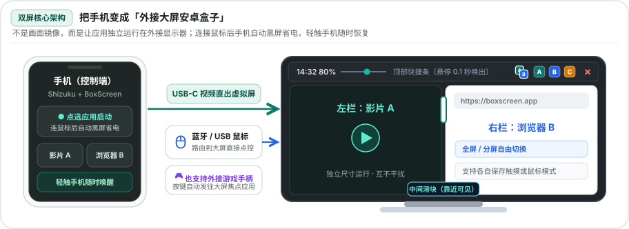
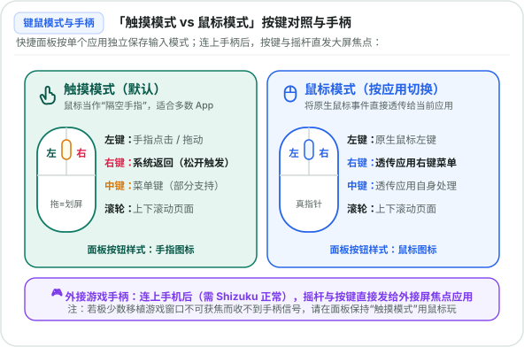
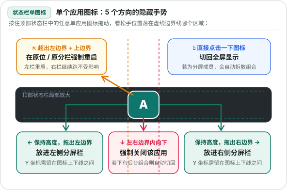
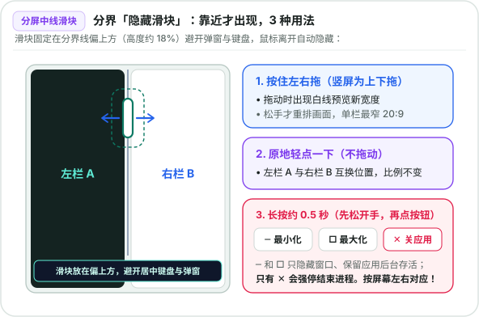
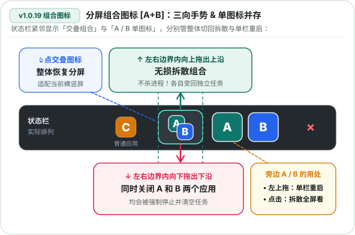

# BoxScreen 使用手册

本手册适用于以下设备与系统配置：

| 设备 | 系统版本 | 构建信息 |
|---|---|---|
| OnePlus 16（PYB110） | Android 17（API 37） | `PYB110_17.0.0.157(CN01)` |
| OnePlus 8（IN2010） | 第三方 Android 16（API 36） | `BP4A.251205.006` |

OnePlus 8 的支持针对上表中的第三方系统构建，不代表原厂 OxygenOS 或所有第三方 ROM。BoxScreen 运行在连接了支持视频输出的外接显示器的手机上。

在 App 内可从首页右上角进入「设置 → 帮助文档」。也可直接打开[网页版本](OPERATION_GUIDE_zh-CN.html)。



## 1. 使用前准备

1. 将手机连接到支持视频输出的外接显示器。
2. 在手机安装并启动 Shizuku。根据 Shizuku 提供的启动方式完成授权；非 Root 环境通常需要按 Shizuku 指引使用无线调试启动。
3. 安装 BoxScreen。第一次创建虚拟屏时，在系统弹窗中允许 BoxScreen 使用 Shizuku。
4. 如果要用鼠标控制外接屏应用，将蓝牙或 USB 鼠标连接到手机。

从 GitHub 安装官方 Release 时，如果手机上已安装自行构建的 Debug 版，因签名不同需要先卸载 Debug 版再安装；卸载会清除 BoxScreen 保存的收藏和 DPI 设置。

Shizuku 和 BoxScreen 都运行在手机上。鼠标配对也在手机上完成。

## 2. 启动应用到外接显示器

1. 打开 BoxScreen。此时不会自动创建虚拟屏，也不会自动黑屏。
2. 在应用网格中点击要运行的应用。
3. 如果虚拟屏尚未创建，BoxScreen 会按外接显示器当前模式创建；如果已经创建，则复用当前虚拟屏。
4. 应用启动后会显示在外接屏，手机主屏仍显示 BoxScreen 控制界面。

部分应用可能不支持 Android 副屏，或会自行回到主屏、忽略竖屏方向。此类行为通常取决于应用自身。

## 3. 鼠标控制和手机黑屏

### 自动鼠标

连接鼠标后，点击应用启动时，BoxScreen 会尝试自动把鼠标路由到外接屏，并将鼠标事件转发给虚拟屏中的应用。外接屏上的光标由 BoxScreen 绘制，点击位置会映射到当前虚拟屏画面。

主界面的“开启鼠标 / 鼠标已开”按钮可手动开启或关闭鼠标转发。关闭后系统会移除 BoxScreen 的鼠标路由，鼠标回到本机常规使用状态。再次点击应用时，BoxScreen 会重新尝试自动启用。

### 输入模式：触摸模式与鼠标模式



输入方式按应用分别保存（默认触摸模式），可在快捷面板用手指/鼠标图标切换，也可以在面板内为每个应用单独设置。

两种模式下鼠标三个按键的行为不同：

| 按键 | 触摸模式 | 鼠标模式 |
|---|---|---|
| 左键 | 触摸点击 / 按住拖动（等价手指） | 普通鼠标点击，由应用解释 |
| 右键 | **返回键**（松开生效） | 透传给应用（多数应用弹右键菜单） |
| 中键 | **菜单键**（松开生效） | 透传给应用（多数应用无动作） |
| 滚轮 | 滚动页面 | 滚动页面 |

- 触摸模式下的右键=返回、中键=菜单是为了让没有鼠标适配的应用也能完成导航和呼出菜单；连点返回时每 250ms 最多生效一次（过快会触发系统的显示切换等待，导致输入卡顿）。
- 左键按住拖动在两种模式下含义不同：触摸模式拖动的是“手指”，鼠标模式拖动的是“鼠标指针”。
- 外接手柄（游戏手柄）：连接后按键和摇杆按输入焦点投递到外接屏上的应用，无需额外设置；需要 Shizuku 正常连接。个别应用窗口不可获焦（如部分移植游戏）时收不到手柄输入，这类应用请用触摸/鼠标操作。

### 自动黑屏与手动黑屏

- 检测到鼠标并成功启用自动转发后，点击应用会把手机屏幕亮度调到最低并覆盖为黑屏，外接屏上的应用继续运行。
- 触摸手机屏幕任意位置会解除黑屏，并恢复 BoxScreen 窗口原来的亮度设置。第一次触摸用于唤醒；恢复后可以继续操作手机。
- 不连接鼠标时，点击应用不会自动黑屏。
- 主界面的“手机黑屏”按钮可以手动黑屏，不要求先连接鼠标。触摸手机可恢复。
- 停止输出、Shizuku 服务断开或退出 BoxScreen 时，应用会移除黑屏并恢复原来的窗口亮度。

### 外接屏快捷面板



- 鼠标移到外接画面上沿约 100 毫秒，会出现 BoxScreen 快捷条；移开后快捷条或下拉面板约 100 毫秒后收起。按住快捷条并向下拖动可展开面板。
- 顶部快捷条显示 Android 最近任务中的应用图标，同一应用只显示一个图标；已有完整分屏组合（前台或后台）时，除了分别显示两个单应用图标外，还会紧邻展示一个左上/右下交叠的组合图标。点击组合图标可切换或恢复分屏；点击其中某个单应用图标则会退出/拆散分屏并切回该应用全屏，对该单应用图标向左上拖依然可直接快速重启对应分栏中的应用。
- 面板可调节媒体音量，并显示最多 12 个应用快捷入口；收藏应用会排在前面。点击入口即可在虚拟屏切换到该应用；若点击的正是当前后台分屏组合中的某一个应用，会自动拆散后台组合并切到该应用全屏显示。面板还可调节 DPI、切换横屏/竖屏效果，以及切换当前应用的触摸/鼠标输入模式。
- 拖动快捷条最近任务图标可执行操作：单应用图标在原有上下边界内向左或向右拖出松开，可放进对应分屏栏；拖到左上方松开，可强制停止并在原位置重启；拖到下方（X 坐标仍在图标范围内）松开，可强制停止并关闭该应用（前台与后台应用均可；关闭后台应用时不影响当前前台画面）。分屏组合图标支持在左右边界内向上拖过上边界无损拆散、向下拖过下边界同时关闭两个应用。拖动期间快捷条不会自动隐藏。
- 点击快捷条最右侧的“×”关闭当前前台应用；如果下方正好是后台保留的分屏组合，关闭上层应用后会自动切回该分屏组合。
- 面板右侧的截图图标会截取虚拟屏画面，保存到 `Pictures/Screenshots`，不会把手机上的快捷面板或状态栏截进去。截图缩略预览会显示在外接屏上；点开后可删除，或在外接屏用系统图库打开。
- 输入模式按应用分别保存，默认是触摸模式。点击面板中的手指/鼠标图标只影响当前虚拟屏应用。
- 这是 BoxScreen 绘制的快捷面板，提供音量、应用切换和输入模式控制，不是 Android 通知栏或完整的系统快捷设置面板。

## 4. 分屏

同一个虚拟屏可以左右（横屏）或上下（竖屏）摆放两个应用，各自独立运行。

### 进入分屏

1. 先在虚拟屏中打开一个应用。若虚拟屏当前有前台任务，快捷面板的“分屏”按钮会以该任务作为第一栏；关闭上层应用后露出的全屏任务也可以继续分屏。
2. 把鼠标移到外接画面上沿，约 100 毫秒唤出快捷条，再向下拖动展开面板。
3. 点击“分屏”。当前前台任务留在左侧（竖屏为上方），另一侧出现应用选择器。
4. 在选择器中点击第二个应用，它会在空出的那一栏启动。

- 分屏按钮在虚拟屏有可分屏的全屏前台任务时显示；分屏进行中不显示。
- 也可以拖动快捷条图标或面板应用卡片左右分屏。松开时 Y 坐标必须仍在原图标/卡片的上下范围内，且 X 坐标要拖到其左右边界之外。向左松开会放入左栏（竖屏为上栏），向右松开会放入右栏（竖屏为下栏）。
- 从全屏开始时，当前前台应用会留在另一栏；如果拖动的正是当前应用，则另一栏进入应用选择状态。已经分屏时，拖入目标栏会替换该栏应用并保留原任务；拖入另一栏已有的应用会最大化该应用。
- 选择器里会优先列出最近打开过的应用。
- 两栏之间没有黑边或缝隙：画面首尾相接，由那根细长的滑块标示分界。

### 分隔滑块



分界线上有一个 12×64 像素的细长滑块，位于画面高度约 18%（偏上）处，为的是躲开居中弹窗和悬浮输入法。

- **默认不显示**：鼠标靠近分隔线（水平方向约 24 像素、垂直方向约 44 像素以内）才出现，鼠标离开就消失，不遮挡画面内容。
- **拖动调整比例**：按住滑块左右（竖屏为上下）拖动，会实时显示一条白色落点线；松开后按落点重新分配两栏宽度。单栏最窄按 20:9 限制，拖不过去时不会继续变窄。
- **点击交换**：按住不拖直接松开（位移小于 4 像素），左右两栏交换位置，比例保持不变。

### 分栏菜单（─ □ ✕）

在滑块上按住约半秒弹出菜单，滑块两侧各有一组，分别对应屏幕上那一侧的应用：

| 图标 | 作用 |
|---|---|
| ─ | 最小化：这一栏的应用隐藏，回到应用选择器；应用进程保留 |
| □ | 最大化：这一栏铺满虚拟屏，另一栏的应用隐藏但继续运行 |
| ✕ | 关闭：强制停止这一栏的应用并清掉它，另一栏不受影响 |

- 菜单按「屏幕上的位置」区分左右，交换窗口后再长按，按钮仍然是操作你看到的那一侧。
- 交换、拖动都会取消这一次的长按菜单；菜单打开后需要先松开按键，再点击按钮才会生效。
- 点击菜单以外的位置只关闭菜单，不执行任何操作。

### 最小化、最大化之后

- 最小化和最大化都不会杀掉应用，只是把窗口隐藏起来。
- 最大化后如果想回到分屏，在那一栏的应用选择器里重新选择被隐藏的应用，它会带着原来的状态回到原来的位置（而不是重新启动一个）。
- 关闭（✕）是唯一会结束应用的按钮。

### 后台保留分屏组合与组合手势



- **后台保留单组组合**：分屏开启两个应用后，直接从应用列表、最近任务（非组合操作）或截屏图库打开第三个全屏应用时，原分屏组合会整体退入后台保留，状态栏中同时显示左上/右下交叠的组合图标以及两个单应用图标（便于直接对任一应用快速重启或单独切换）。
- **恢复与自动切回**：点击状态栏中的组合图标即可将分屏整体拉回前台（后台期间切换横竖屏后，切回时会自动按新方向重排）。若当前前台应用处于该组合上方，通过快捷条右上角“×”或状态栏向下拖动关闭该前台应用后，BoxScreen 会自动切回下方的分屏组合。
- **直接启动组合内应用会拆散**：当分屏组合位于后台时，若直接从应用列表点击组合内的任一应用图标（非点击组合图标），系统会拆散后台组合并将其切到前台全屏。
- **组合图标上拖 / 下拖手势**：
  - 按住状态栏组合图标，在图标左右边界内**向上拖过上边界**松开：拆散当前分屏组合（前台/后台均支持），**不会结束任一应用进程**——后台组合会还原为两个普通全屏任务，前台组合保留当前活跃侧全屏、另一侧退入后台，状态栏恢复显示两个独立应用图标。
  - 按住状态栏组合图标，在图标左右边界内**向下拖过下边界**松开：强制停止并关闭组合中的两个应用（前台/后台均支持）。

### 已知限制

- 分屏基于虚拟屏内的两个 Task 容器，应用自身如果不支持多窗口，可能仍会以全屏方式显示。
- 竖屏分屏是上下两栏，鼠标指针方向与横屏一致。
- 分屏期间切换横竖屏会按当前比例重建两栏布局。

### 输出缓冲（自动）

BoxScreen 会按输出画面大小自动选择输出管线，不需要手动切换：

- **画面超过 250 万像素（例如 2560×1440）**：经中间缓冲送往外接屏，减少重复帧。缓冲会增加 GPU 绘制和显存开销，延迟取决于实际合成。
- **画面不超过 250 万像素（例如 1920×1080）**：直接输出。
- **竖屏**：Android 16 或更新版本可按相同条件启用缓冲，最终画面复用直出路径的图层旋转。较早版本沿用原有的竖屏输出。

## 5. 方向、DPI 和显示器

- “横屏 · 切换竖屏”按钮用于切换外接画面展示效果。外接显示器的视频信号仍保持其当前横向模式。
- 快捷面板中的 DPI 滑块范围为 **140–600 DPI**，步进为 **10 DPI**。松开滑块后应用，显示刷新可能需要一点时间；横屏和竖屏分别保存自己的 DPI。快捷条和面板的文字、控件及点击区域会一起按虚拟屏 DPI 缩放。
- 对文字显示异常的应用，可在快捷面板为当前应用开启“主屏 DPI 同步”。启用后手机主屏 DPI 会临时跟随当前虚拟屏 DPI，手机上的文字和布局也可能变化。切换到未开启此设置的应用、关闭开关或停止输出时，BoxScreen 会尝试恢复之前的主屏 DPI；恢复需要 Shizuku 正常连接。部分应用可能需要重新打开或重新适配后才显示正常。
- UU 远程使用专用虚拟屏配置，以避免键盘操作后鼠标捕获影响 BoxScreen 光标；切换进入或离开 UU 远程时会重建虚拟屏。UU 远程请关闭其“沉浸式鼠标”选项。
- 切换横竖屏时，鼠标指针会按屏幕比例调整位置；竖屏指针顺时针旋转 90°，鼠标移动和点击仍对应虚拟屏内容。
- 从竖屏切回横屏时，鼠标坐标会在新方向下重新校准，避免鼠标的可达范围缩短。
- 屏幕上方会显示外接显示器名称、当前分辨率、刷新率、运行时显示 ID 和密度。显示 ID 会随 Android 会话变化，不应手动假定为固定数字。
- “停止输出”会释放虚拟屏。之后再次点击应用时会重新创建。

## 6. 应用列表

- 使用搜索框按应用名称或包名过滤。
- 默认隐藏系统应用；在设置里打开“显示系统应用”开关后显示。
- 点击“编辑收藏”进入收藏编辑状态，选中应用后点“完成”。收藏应用会排在列表前面。
- 网格列数会按手机方向和可用宽度变化；竖屏默认尽量保持四列。

## 7. 故障处理

### 没有检测到外接屏

检查 USB-C 视频连接、显示器输入源和 Android 是否识别到外接显示器，然后重新打开 BoxScreen。

### 点击应用后没有创建虚拟屏

确认 Shizuku 正在运行，并在 Shizuku 弹窗中授予 BoxScreen 权限。Shizuku 停止或重启后，回到 BoxScreen 再点击一次应用。

### 鼠标没有出现或无法控制应用

确认鼠标已连接到手机，且 BoxScreen 主界面显示鼠标转发已开启。尝试先关闭再重新开启鼠标转发。若鼠标只显示但点击偏位，确认虚拟屏横竖屏模式与外接画面一致。

### 右键/中键（或手柄）没有反应

- 确认当前应用的输入模式：右键=返回、中键=菜单只在**触摸模式**下生效；鼠标模式下按键由应用自己解释。
- 确认鼠标转发已开启（主界面按钮显示"鼠标已开"）。
- 黑屏状态（虚拟屏上没有应用）时，右键/中键不执行任何操作——此时没有可"返回"的对象。
- 手柄收不到输入的应用多为窗口不可获焦（部分移植游戏），换触摸模式操作。

### DPI 或方向改变后应用没有适配

Android 会向应用发送显示配置变化，但个别应用会缓存布局、锁定方向或不响应副屏配置。可先关闭并重新打开该应用；其他应用和虚拟屏不受影响。

### 打开应用后白色指针不出现

若个别情况下转发状态与系统路由不同步（例如手机息屏/前台切换后），在主界面把"鼠标已开"点成关闭、再点一次开启即可重建路由。新版已修复自动恢复逻辑；如仍遇到，请反馈设备型号和 Android 版本。

### 手机一直黑屏

触摸屏幕任意位置即可恢复。若触摸无响应，可按电源键唤醒系统；BoxScreen 在停止输出、Shizuku 断开或 Activity 退出时也会恢复亮度和系统栏。

## 8. 构建

```sh
./gradlew assembleDebug
```

需要 JDK 17+ 和 Android SDK Platform 36。调试 APK 位于 `app/build/outputs/apk/debug/app-debug.apk`。Release 签名密钥由发布者在本机保管，不会提交到仓库。

### 设置与更新

- 「外观」分别选择主题风格（锤子或液态玻璃）和明暗模式（跟随系统、浅色或暗色）；浅色液态玻璃下外接屏状态栏与快捷面板会自动感应底层画面明暗以保持文字与按钮清晰可读。
- 「帮助文档」打开内置离线交互图解。
- 「关于」显示当前版本并支持行内「检查更新」（查询最新正式 Release，发现新版可交给浏览器下载官方 APK 并由 Android 确认安装）；点击「发行说明与历史版本」可直接打开 GitHub Releases 页面查看历史版本与更新日志。
- 外接屏状态栏的闪电表示正在充电，插头表示已接电但当前未充电。
